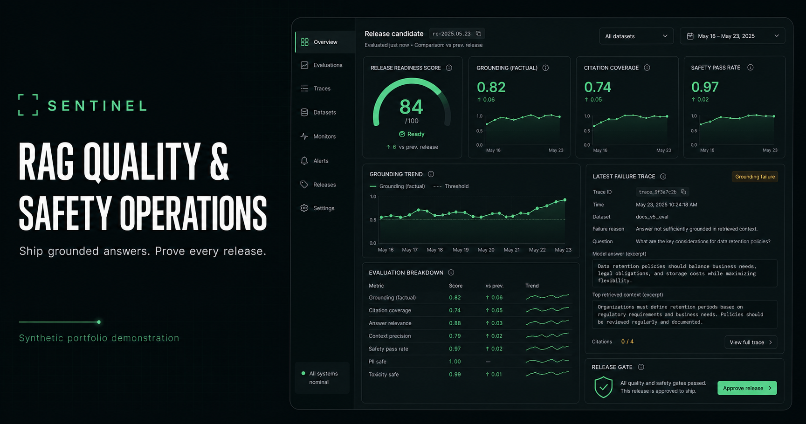
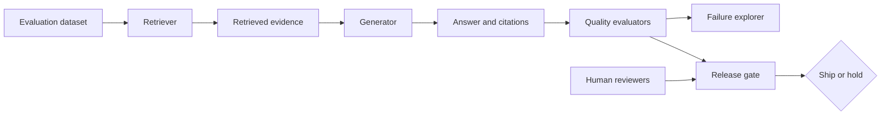

# Sentinel — RAG Quality & Safety Operations



Sentinel is an interactive portfolio demonstration of how an AI engineering team can evaluate, investigate, and govern RAG releases before they reach users.

**Live demo:** [sentinel-rag-operations.vercel.app](https://sentinel-rag-operations.vercel.app)

> All metrics, traces, prompts, documents, and incidents in this repository are synthetic. No client, patient, employee, or proprietary data is included.

## Why this exists

RAG systems need more than a good-looking answer. A production release should make it possible to answer:

- Did retrieval return the evidence needed to answer the question?
- Are material claims supported by citations?
- Did a candidate release improve quality without introducing regressions?
- Does the system abstain when evidence is insufficient?
- Who reviewed and approved the release?

Sentinel turns those questions into an operations workflow rather than a collection of disconnected metrics.

## Product surfaces

- **Operations overview** — grounding, citation coverage, safe-abstention, latency, and readiness signals
- **Evaluation runs** — candidate-versus-production comparison across a synthetic evaluation set
- **Failure explorer** — inspect retrieval traces, unsupported claims, diagnosis, and recommended action
- **Release gate** — measurable checks plus explicit human sign-off before shipment

## Architecture



The current repository focuses on the product and interaction layer. Its synthetic state is intentionally deterministic so reviewers can explore the complete workflow without cloud credentials, API keys, or private datasets.

## Engineering decisions

- Quality signals are separated into grounding, citation coverage, abstention behavior, and latency rather than collapsed into one opaque score.
- Release approval is modeled as a human-controlled decision, not an automatic LLM action.
- Failure cases preserve the retrieval-to-generation trace so regressions can be diagnosed instead of merely counted.
- The interface visibly distinguishes synthetic demonstration data from production claims.
- The social preview is generated from the same visual system used by the application.

## Run locally

Requirements: Node.js 22.13 or newer.

```bash
npm install
npm run dev
```

Production validation:

```bash
npm run lint
npm test
```

## Stack

- TypeScript
- React 19
- Vinext / Vite
- Cloudflare-compatible server runtime
- CSS-driven responsive data visualization

## Scope and limitations

This is a frontend-focused reference product, not a claim of a live customer monitoring deployment. A production implementation would connect the same workflow to versioned evaluation datasets, trace storage, evaluator services, access control, audit logs, and CI/CD release policies.

## Author

**Raghu Sharma** — Senior AI/ML Engineer

- [Portfolio](https://rs-portfolio-teal.vercel.app/)
- [GitHub](https://github.com/raghurs49)
- [LinkedIn](https://www.linkedin.com/in/raghu-sharma-7091b4115/)
